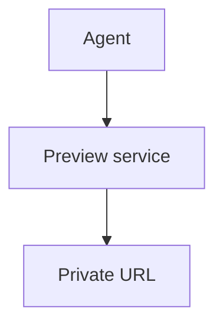

# Markdown documents

Write documents in Markdown by default. `publish` renders a `.md` file into the shared
shell, so every document gets the same outline rail, theme, diagrams, and phone
layout without hand-written markup. Read [document-design.md](document-design.md) for
what each component is for; this file covers how to write them in Markdown.

## Skeleton

```markdown
---
title: Gate the subscription before the migration
kicker: FE impact analysis
summary: Why the billing gate ships first, what it costs, and what would reverse the call.
---

One or two sentences that state the answer. The first paragraph becomes the lede.

## First section

Body text.
```

- `title` and `summary` are required. The summary is the meta description and the
  catalog blurb. `kicker` is the small label above the title. Quote values that
  contain `:` or `#`.
- Instead of a `title:` line, the file may start with a single `# Title`. Use no other
  `#` headings.
- Every `##` starts a numbered section in the outline. Use `###` inside sections.
- Add an eyebrow or right-aligned meta line by putting a block attribute line directly
  above the heading:

  ```markdown
  {eyebrow="Decision" meta="Scope: billing only"}
  ## Gate the subscription first
  ```

## Built-in Markdown

- Paragraphs, lists, links, emphasis, `inline code`, `> quotes`, `---` rules.
- **Tables** in GFM pipe syntax. They are wrapped automatically. A right-aligned column
  (`---:`) gets the numeric style. On phones each row becomes a card with labelled values.
- `- [x]` task lists, and `Term` / `: definition` lists.
- Bare URLs autolink. External links open in a new tab.

## Code

````markdown
```ts title="Cost model"
const total = base + usage;
```
````

`title="..."` adds a caption above the block; `label="..."` overrides the language
shown next to it. The runtime highlights the code and adds Copy and Wrap buttons. Code
wraps by default on phones.

## Mermaid

````markdown

````

- Always give `title="..."`: it is the figure caption and names the JPG download.
  `caption="..."` replaces the default hint text.
- Prefer `flowchart TD` (top-down). A tall diagram fits a phone screen; a wide `LR`
  chain shrinks to unreadable text. Keep node labels to a few words.
- `stateDiagram` sources render with Pele. Paste `chart.mmd` unchanged (see the state
  chart rules in document-design.md).
- On phones the inline diagram is a preview: a tap opens it fullscreen, where one
  finger pans and two fingers zoom.

## Containers

Fence a component with `:::`. Nest by giving the outer fence more colons.

| Markdown | Renders |
|---|---|
| `::: callout` | Pink-ruled aside for a caveat or implication |
| `::: note` | Muted note for assumptions, dates, exclusions |
| `::: verdict Title` | Highlighted decision box (title defaults to "Recommendation") |
| `::: panel Optional title` | Bordered group |
| `::: details Summary text` | Collapsed section; add `open` at the end to start expanded |
| `::: metrics` | Headline figures from a `- Label: value` list |
| `::: timeline` | Numbered steps from a `1. **Title** - text` list |
| `:::: grid two` / `three` / `sidebar` | Side-by-side children (stacked on phones) |
| `::: columns`, `::: prose` | Two-column prose, spaced prose |
| `::: sources` | Numbered source list from a bulleted list of links |

```markdown
::: verdict Ship the gate first
Gate now, migrate next sprint. Reverse this if **billing** slips past March.
:::

::: metrics
- Monthly cost: **$247**
- Active agents: 100
:::

::: timeline
1. **Align the contract** - confirm the data and migration boundary.
2. **Ship the gate** - behind a flag, on for internal workspaces.
:::

:::: grid two
::: panel Option A
Managed service.
:::
::: panel Option B
Self-hosted.
:::
::::

::: details Raw webhook payload
```json
{ "id": 1 }
```
:::
```

In `::: metrics`, wrap a value in `**bold**` to color it as the accent.

## Custom components

Raw HTML passes through unchanged, so drop to markup when Markdown runs out: an inline
SVG chart, a `<div class="table-wrap scroll">` table that must stay a grid on phones,
a `<tr class="recommended">` row, or a one-off component with its own `<style>` and
`<script type="module">`.

- Leave a blank line before and after an HTML block. Markdown inside an HTML block is
  not parsed unless it is separated by blank lines.
- Use the shared CSS variables (`var(--pink)`, `var(--ink)`, `var(--muted)`,
  `var(--line)`, `var(--raised)`) so the component follows light and dark themes.
- Keep it at most 100% wide, or put it in its own scroller, so the page never scrolls
  sideways on a phone. `just mobile-check` in `~/docker/html-preview` catches overflow.
- The downloaded HTML strips scripts, so the meaning must survive without them.
- Give a top-level `<svg>` a `role="img"` and an `aria-label`.

For a document that is mostly custom layout, write HTML instead: run `new` with an
`.html` output and follow document-design.md.
